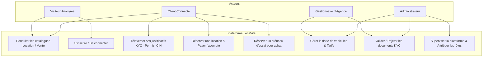
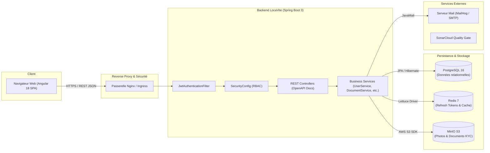
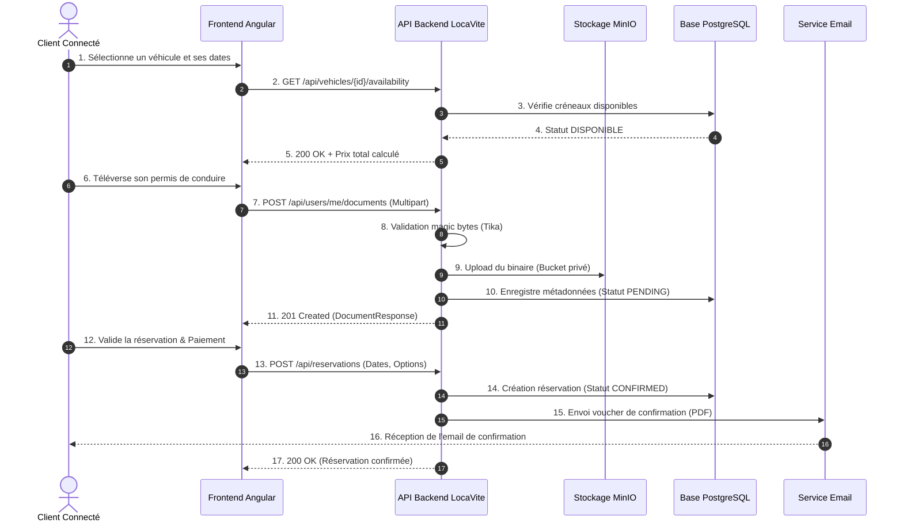
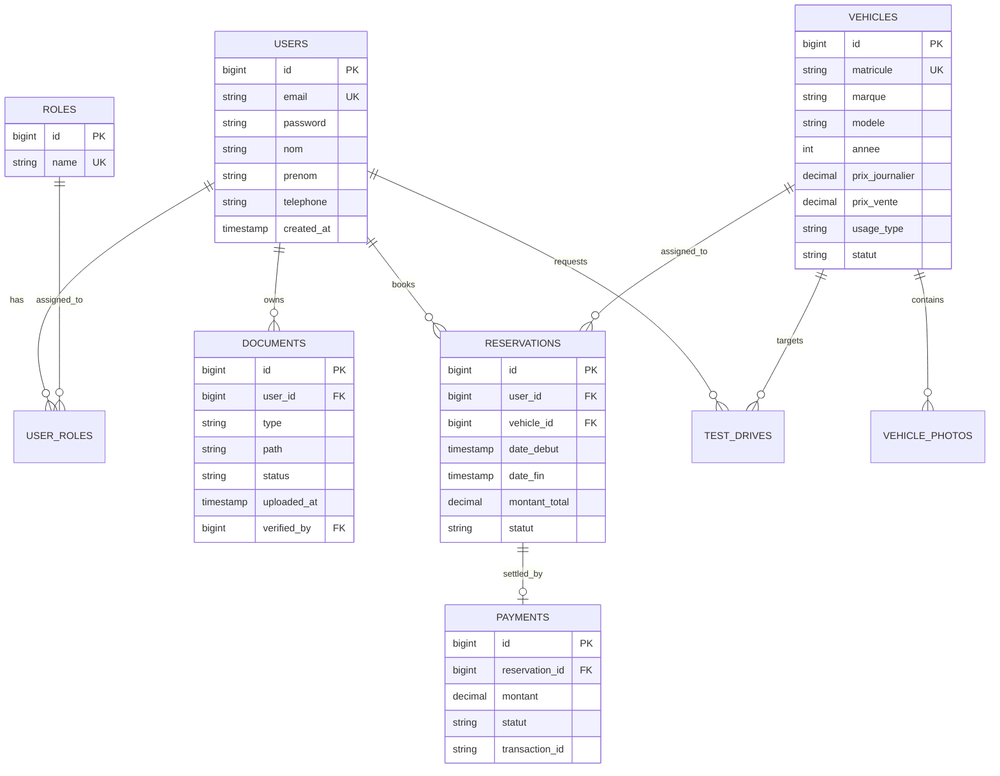
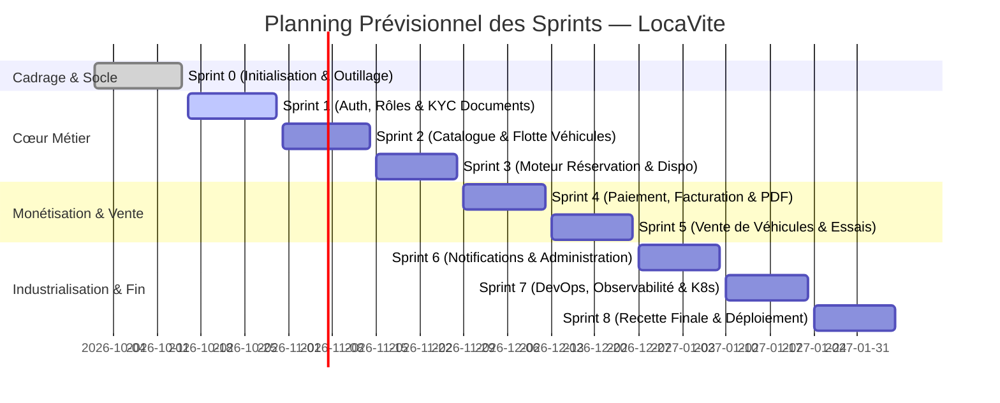

# 📘 Cahier des Charges Fonctionnel et Technique — Projet LocaVite

---

## 📑 Métadonnées du Document

| Propriété | Valeur |
|---|---|
| **Projet** | **LocaVite** — Plateforme Digitale de Location et Vente de Véhicules au Maroc |
| **Document** | Cahier des Charges Fonctionnel & Technique (CdC) |
| **Version** | **1.0.0** |
| **Statut** | Soumis pour validation |
| **Date d'émission** | 21 Octobre 2026 |
| **Auteurs** | Équipe d'Ingénierie LocaVite (Scrum Master, Backend Developers, Frontend Developer, DevOps) |
| **Destinataire / Encadrant** | Encadrant pédagogique & Responsable de filière |
| **Dépôt GitHub** | [`Amine-Genin/LocaVite`](https://github.com/Amine-Genin/LocaVite) |
| **Spécification API** | OpenAPI 3.0 / Swagger ([`docs/openapi.json`](openapi.json)) |
| **Maquettes UI/UX** | Figma ([`Design LocaVite.pdf`](../Design%20LocaVite.pdf)) |

---

## 📋 Table des Matières

1. [Contexte et Objectifs du Projet](#1-contexte-et-objectifs-du-projet)
2. [Périmètre Fonctionnel](#2-périmètre-fonctionnel)
   - [2.1 Volet Location de Véhicules](#21-volet-location-de-véhicules)
   - [2.2 Volet Vente de Véhicules](#22-volet-vente-de-véhicules)
3. [Acteurs, Rôles et Matrice des Droits](#3-acteurs-rôles-et-matrice-des-droits)
4. [Exigences Fonctionnelles Détaillées](#4-exigences-fonctionnelles-détaillées)
5. [Exigences Non-Fonctionnelles](#5-exigences-non-fonctionnelles)
   - [5.1 Performance et Scalabilité](#51-performance-et-scalabilité)
   - [5.2 Sécurité et Protection des Données](#52-sécurité-et-protection-des-données)
   - [5.3 Internationalisation et Localisation](#53-internationalisation-et-localisation-i18nl10n)
   - [5.4 Disponibilité et Résilience](#54-disponibilité-et-résilience)
   - [5.5 Ergonomie et Accessibilité](#55-ergonomie-et-accessibilité)
6. [Architecture et Contraintes Techniques](#6-architecture-et-contraintes-techniques)
7. [Diagrammes Fonctionnels et Techniques](#7-diagrammes-fonctionnels-et-techniques)
   - [7.1 Diagramme des Cas d'Utilisation](#71-diagramme-des-cas-dutilisation)
   - [7.2 Diagramme d'Architecture Système](#72-diagramme-darchitecture-système)
   - [7.3 Diagramme de Séquence : Parcours de Réservation](#73-diagramme-de-séquence--parcours-de-réservation)
   - [7.4 Modèle de Données Conceptuel (ERD)](#74-modèle-de-données-conceptuel-erd)
8. [Références aux Maquettes et Design System](#8-références-aux-maquettes-et-design-system)
9. [Livrables du Projet](#9-livrables-du-projet)
10. [Planning Prévisionnel et Roadmap des Sprints](#10-planning-prévisionnel-et-roadmap-des-sprints)
11. [Estimation Budgétaire et Ressources](#11-estimation-budgétaire-et-ressources)
12. [Validation et Sign-off](#12-validation-et-sign-off)

---

## 1. Contexte et Objectifs du Projet

### 1.1 Contexte Général
Le secteur de la mobilité automobile au Maroc connaît une croissance soutenue sous l'impulsion de l'essor touristique, des besoins accrus de mobilité urbaine et interurbaine, ainsi que de l'expansion rapide du marché des véhicules d'occasion. Cependant, les consommateurs et les agences de location/vente font face à des freins majeurs :
- **Opacité tarifaire** : absence de visibilité en temps réel sur la disponibilité et les grilles tarifaires saisonnières.
- **Processus papier chronophages** : vérification manuelle des pièces d'identité et permis de conduire sur place, entraînant des retards et des risques de non-conformité.
- **Manque de confiance** : absence de certification technique pour les véhicules mis en vente et gestion artisanale des acomptes et dépôts de garantie.

### 1.2 Vision de LocaVite
**LocaVite** se positionne comme la première plateforme marocaine tout-en-un offrant une expérience digitalisée, transparente et sécurisée pour :
1. **La location courte et moyenne durée** de voitures avec contractualisation et vérification des pièces (KYC) en amont.
2. **La vente de véhicules d'occasion et neufs** avec inspection préalable, consultation d'historique et réservation en ligne.

### 1.3 Objectifs Stratégiques et Métriques Clés (KPIs)
- **Fluidité de l'expérience utilisateur** : réservation de véhicule complétée en moins de **3 minutes**.
- **Digitalisation 100% du KYC** : vérification numérique sécurisée de la Carte d'Identité Nationale (CIN) et du Permis de conduire avant la prise du véhicule.
- **Fiabilité opérationnelle** : taux de disponibilité système de **99.5%** et temps de réponse API P95 inférieur à **200 ms**.
- **Qualité logicielle industrielle** : couverture de tests supérieure à **70%**, zéro dette technique critique (SonarCloud Quality Gate strict).

---

## 2. Périmètre Fonctionnel

Le périmètre couvre deux piliers métiers complémentaires et articulés autour d'un référentiel commun d'utilisateurs et de véhicules.

### 2.1 Volet Location de Véhicules
- **Catalogue & Filtres multi-critères** : recherche par ville/agence, dates et heures de départ/restitution, catégorie (citadine, berline, SUV, utilitaire, premium), type de boîte (manuelle/automatique), motorisation (essence, diesel, hybride, électrique).
- **Moteur de disponibilité en temps réel** : gestion dynamique du calendrier pour prévenir tout surbooking.
- **Tarification flexible** : tarification journalière dégressive, suppléments pour options (siège bébé, GPS, conducteur additionnel) et forfaits kilométriques.
- **Gestion des formalités (KYC)** : dépôt numérique sécurisé du permis de conduire et de la CIN avec validation par l'agence ou l'administrateur.
- **Dépôt de garantie & Paiement sécurisé** : paiement de l'acompte ou du montant total en ligne avec gestion de l'empreinte bancaire pour la caution.
- **Contrat numérique & État des lieux** : génération automatique de contrat de location au format PDF téléchargeable.

### 2.2 Volet Vente de Véhicules
- **Catalogue Vente** : vitrine de véhicules disponibles à l'achat, neufs ou d'occasion certifiée.
- **Fiches descriptives complètes** : kilométrage certifié, historique d'entretien, caractéristiques techniques complètes, galerie photos haute résolution.
- **Prise de rendez-vous d'essai** : sélection d'un créneau horaire en agence pour tester le véhicule.
- **Réservation de véhicule à l'achat** : versement d'un acompte de blocage en ligne pour bloquer le véhicule pendant une durée définie (ex. 72h).
- **Accompagnement administratif** : mise à disposition de la documentation de cession légale marocaine (procédure de mutation de carte grise).

---

## 3. Acteurs, Rôles et Matrice des Droits

La plateforme distingue 4 profils d'utilisateurs avec gestion fine des permissions (RBAC) :

| Profil | Code Rôle | Description et Responsabilités |
|---|---|---|
| **Visiteur (Anonyme)** | `ANONYMOUS` | Utilisateur non connecté pouvant consulter les catalogues publics (location/vente), les avis, et initier une inscription. |
| **Client** | `ROLE_CLIENT` | Particulier ou professionnel inscrit. Il peut louer un véhicule, déposer ses justificatifs KYC, réserver un créneau d'achat, payer en ligne et gérer son profil. |
| **Gestionnaire d'Agence** | `ROLE_AGENCE` | Professionnel gestionnaire d'un parc de véhicules. Il met à jour son stock, définit les tarifs, valide les documents des clients, et gère les livraisons/restitutions. |
| **Administrateur** | `ROLE_ADMIN` | Supervision globale de la plateforme, modération, attribution et révocation des rôles, validation des documents en cas de litige, suivi analytique. |

### Matrice des Droits (CRUD)

| Fonctionnalité | Visiteur | Client | Agence | Administrateur |
|---|:---:|:---:|:---:|:---:|
| Consultation catalogues (Location & Vente) | R | R | R | R |
| Inscription / Connexion (JWT) | C | C / R | C / R | C / R |
| Gestion du profil personnel | ❌ | C / R / U | C / R / U | C / R / U |
| Dépôt de documents personnels (KYC) | ❌ | C / R / D | ❌ | R (supervision) |
| Validation / Rejet des documents KYC | ❌ | ❌ | R / U | R / U / D |
| Réservation de location & Paiement | ❌ | C / R / U | ❌ | R (supervision) |
| Gestion de la flotte de véhicules | ❌ | ❌ | C / R / U / D | C / R / U / D |
| Prise de rendez-vous d'essai de vente | ❌ | C / R | R / U | R |
| Attribution et modification des rôles | ❌ | ❌ | ❌ | C / R / U |
| Consultation métriques et logs système | ❌ | ❌ | ❌ | R |

---

## 4. Exigences Fonctionnelles Détaillées

### 4.1 Module Authentification, Sécurité et Profils
- **EF-AUTH-01** : Inscription avec validation des champs obligatoires (nom, prénom, email unique, téléphone marocain valide `+212...`, mot de passe fort).
- **EF-AUTH-02** : Authentification stateless basée sur un token d'accès JWT (`accessToken`, durée 24h) et un jeton de rafraîchissement opaque (`refreshToken`) stocké dans Redis avec expiration glissante.
- **EF-AUTH-03** : Révocation instantanée du `refreshToken` lors de la déconnexion.
- **EF-AUTH-04** : Attribution dynamique des rôles (`CLIENT`, `AGENCE`, `ADMIN`) par l'administrateur avec interdiction stricte d'auto-rétrogradation de l'administrateur.

### 4.2 Module Gestion Documentaire & KYC (Know Your Customer)
- **EF-DOC-01** : Téléversement multipart de fichiers d'identité (CIN recto/verso, Permis de conduire).
- **EF-DOC-02** : Détection obligatoire du type MIME réel via magic bytes (Apache Tika) pour refuser les fichiers malveillants exécutables déguisés.
- **EF-DOC-03** : Limitation de la taille des documents à 5 Mo et formats acceptés limités à PDF, PNG, JPG/JPEG.
- **EF-DOC-04** : Stockage sécurisé des objets dans des buckets MinIO privés non publics, avec génération d'URLs présignées temporaires (expiration 15 min).
- **EF-DOC-05** : Workflow de validation administrative des documents (`PENDING` ➔ `VALIDATED` ou `REJECTED` avec motif).

### 4.3 Module Flotte de Véhicules & Catalogue
- **EF-VEH-01** : Gestion complète du cycle de vie du véhicule (immatriculation, marque, modèle, année, kilométrage, type de boîte, carburant, statut : disponible, loué, réservé, en maintenance, vendu).
- **EF-VEH-02** : Attribution du véhicule soit à l'activité de location, soit à l'activité de vente, soit hybride.
- **EF-VEH-03** : Gestion des tarifs par période (haute/basse saison, tarification weekend).
- **EF-VEH-04** : Galerie d'images associées au véhicule stockées sur MinIO avec image principale de couverture.

### 4.4 Module Moteur de Réservation (Location)
- **EF-RES-01** : Sélection de la période de réservation avec vérification d'incompatibilité de dates sur le véhicule choisi.
- **EF-RES-02** : Calcul transparent du prix global : durée × tarif journalier + options + caution requise.
- **EF-RES-03** : Blocage temporaire du véhicule (réservation en statut `PENDING_PAYMENT`) pendant 15 minutes pour finaliser la transaction.
- **EF-RES-04** : Confirmation de réservation, envoi automatique d'email récapitulatif avec voucher PDF généré dynamiquement.
- **EF-RES-05** : Politique d'annulation programmable (annulation gratuite jusqu'à 48h avant la prise en charge).

### 4.5 Module Vente de Véhicules
- **EF-SAL-01** : Fiche détaillée de vente incluant rapport technique d'inspection en 50 points téléchargeable.
- **EF-SAL-02** : Prise de rendez-vous d'essai de conduite en agence avec calendrier de disponibilités des agents.
- **EF-SAL-03** : Option de versement d'un acompte de réservation (ex. 2 000 MAD) pour bloquer l'exclusivité d'achat pendant 72 heures.
- **EF-SAL-04** : Génération des formulaires types de transfert de propriété conformes à l'Agence Nationale de la Sécurité Routière (NARSA).

### 4.6 Module Administration & Supervision
- **EF-ADM-01** : Tableau de bord de synthèse : chiffre d'affaires généré, taux d'occupation de la flotte, réservations en cours, documents en attente de vérification.
- **EF-ADM-02** : Visualisation paginée et filtrée de tous les utilisateurs et affectation des rôles.
- **EF-ADM-03** : Documentation interactive des APIs accessible via Swagger UI avec bouton d'authentification Bearer JWT.

---

## 5. Exigences Non-Fonctionnelles

### 5.1 Performance et Scalabilité
- **Temps de réponse** : < 200 ms pour les requêtes de lecture de catalogue et < 500 ms pour les opérations d'écriture/upload.
- **Pagination systématique** : toutes les API retournant des collections utilisent l'abstraction `Pageable` de Spring Data (par défaut 10 éléments/page).
- **Mise en cache** : mise en cache Redis des référentiels peu changeants (marques, modèles, villes, agences) et des sessions JWT/refresh.
- **Optimisation des assets** : compression des images téléversées et lazy loading côté frontend Angular.

### 5.2 Sécurité et Protection des Données
- **Normes de hachage** : mots de passe hachés avec BCrypt (facteur de coût 12).
- **Authentification & Session** : architecture 100% stateless par token JWT signé en HMAC-SHA512 (`HS512`).
- **Principe du moindre privilège** : contrôle d'accès basé sur les rôles activé avec `@EnableMethodSecurity` et `@PreAuthorize("hasRole('...')")`.
- **Protection des pièces confidentielles** : les fichiers d'identité ne sont jamais accessibles en accès public ; chaque consultation requiert une URL présignée générée après vérification des droits.
- **Validation stricte des entrées** : validation Jakarta sur chaque DTO et vérification du magic number des fichiers pour prévenir l'upload de web-shells.
- **Conformité CNDP** : respect de la loi marocaine n° 09-08 relative à la protection des personnes physiques à l'égard du traitement des données à caractère personnel.

### 5.3 Internationalisation et Localisation (i18n/l10n)
- **Langues supportées** : Français (langue par défaut), Arabe (avec adaptation de l'interface en mode RTL - Right-to-Left) et Anglais.
- **Gestion des devises** : affichage natif en Dirham Marocain (MAD), avec convertisseur indicatif en Euros (€) et Dollars ($).
- **Fuseau horaire** : `Africa/Casablanca` (GMT+1) pour la planification des réservations et des états des lieux.

### 5.4 Disponibilité et Résilience
- **SLA cible** : **99.5%** de disponibilité sur l'environnement de production.
- **Isolation des composants** : base de données PostgreSQL, cache Redis et MinIO conteneurisés avec redémarrage automatique (`restart: unless-stopped`) et healthchecks intégrés.
- **Sauvegarde** : procédure automatisée de backup quotidien des données PostgreSQL et réplication des buckets MinIO.

### 5.5 Ergonomie et Accessibilité
- **Responsive Web Design** : interface fluide adaptée aux smartphones, tablettes et écrans desktop (Mobile First).
- **Accessibilité** : respect des critères WCAG 2.1 (niveau AA) pour le contraste des couleurs et la navigation au clavier.
- **Design System** : basé sur Angular Material 18, reprenant l'identité visuelle définie dans la maquette Figma.

---

## 6. Architecture et Contraintes Techniques

### 6.1 Choix d'Architecture : Monolithe Modulaire (ADR 0001)
Conformément à la décision architecturale **ADR 0001**, LocaVite adopte un **monolithe modulaire** articulé autour de modules découplés par domaine métier :

```text
ma.locavite
├── admin        # Contrôleurs et gestionnaires du back-office
├── auth         # Sécurité, JWT, utilisateurs, rôles et authentification
├── common       # Configurations transverses, exceptions globales, utilitaires
├── document     # Gestion des justificatifs KYC et intégration MinIO
├── vehicle      # Gestion de la flotte et des catalogues location/vente
├── reservation  # Moteur de calcul, calendrier et réservations
└── payment      # Facturation et intégration des passerelles de paiement
```

### 6.2 Matrice des Technologies Épinglées

| Domaine | Outil / Composant | Version Épinglée | Rôle et Justification |
|---|---|---|---|
| **Langage Backend** | Java | **21 LTS** | Performance, virtual threads, switch pattern matching. |
| **Framework Backend** | Spring Boot | **3.3.4** | Socle web moderne, sécurité 6, validation, ORM. |
| **Sécurité Web** | Spring Security & JJWT | **6.3.3 / 0.12.6** | Authentification stateless, RBAC et signature HS512. |
| **Base de Données** | PostgreSQL | **16 Alpine** | Robustesse relationnelle, intégrité référentielle, indexation JSONB. |
| **Gestion Schéma** | Flyway DB | **9+** | Migrations incrémentales immuables (`V1`, `V2`, etc.). |
| **Cache & Sessions** | Redis | **7 Alpine** | Stockage haute vitesse des refresh tokens et cache de requêtes. |
| **Stockage Objet** | MinIO | **RELEASE.2024** | Stockage d'images et documents compatible AWS S3. |
| **Framework Frontend**| Angular | **18.2.10** | Framework SPA moderne, standalone components, typage fort. |
| **Composants UI** | Angular Material | **18.2.10** | Composants riches conformes aux standards Material Design. |
| **Documentation API**| SpringDoc OpenAPI | **2.6.0** | Swagger UI et spécification OpenAPI v3 générée à chaque build. |
| **Couverture & Qualité**| JaCoCo & SonarCloud | **0.8.12 / v5** | Contrôle qualité continu et Quality Gate bloquant (>70%). |

---

## 7. Diagrammes Fonctionnels et Techniques

### 7.1 Diagramme des Cas d'Utilisation
Ce diagramme synthétise les interactions entre les acteurs et les grands sous-systèmes de la plateforme.



---

### 7.2 Diagramme d'Architecture Système
Ce diagramme détaille l'organisation de l'infrastructure conteneurisée et le flux des données.



---

### 7.3 Diagramme de Séquence : Parcours de Réservation et Dépôt KYC
Le diagramme suivant illustre le cheminement complet d'une réservation de location avec contrôle de disponibilité et vérification documentaire.



---

### 7.4 Modèle de Données Conceptuel (ERD)
Ce modèle présente les entités fondamentales et leurs associations dans la base de données PostgreSQL.



---

## 8. Références aux Maquettes et Design System

L'expérience visuelle et ergonomique de LocaVite est entièrement formalisée dans la maquette interactive **Figma** et son export haute fidélité intégré au dépôt :

- **Document source Figma** : Export haute définition conservé sous [`Design LocaVite.pdf`](../Design%20LocaVite.pdf) (à la racine du dépôt).
- **Charte Graphique et Couleurs** :
  - **Couleur Primaire (Bleu Roi)** : `#1E3A8A` (confiance, rigueur, professionnalisme automobile).
  - **Couleur Secondaire (Orange Ambré)** : `#F97316` (actions clés, réservation, dynamisme).
  - **Arrière-plans et cartes** : surfaces neutres claires `#F8FAFC`, ombrages subtils Material elevation.
  - **Typographie** : Police sans-serif moderne (*Inter* / *Roboto*), offrant une lisibilité optimale sur écrans mobiles.
- **Écrans Clés Modélisés** :
  1. **Page d'Accueil (Landing Page)** : moteur de recherche rapide avec onglets bascule "Louer" et "Acheter", sélection de ville et dates.
  2. **Page Catalogue & Filtres** : affichage en grille/liste avec filtres dynamiques (catégorie, prix, boîte, énergie).
  3. **Fiche Véhicule Détaillée** : carrousel d'images HD, spécifications, conditions de location, calculatrice de tarif et bouton d'action principal.
  4. **Tunnel de Réservation en 3 étapes** : récapitulatif, formulaire d'upload KYC avec drag & drop, sélection des options et paiement.
  5. **Espace Client ("Mon Compte")** : statut des pièces KYC téléversées, historique des réservations, factures PDF téléchargeables.
  6. **Tableau de Bord Back-Office Agence / Admin** : gestion du statut de la flotte, modération des justificatifs utilisateurs et statistiques de revenus.

---

## 9. Livrables du Projet

Le projet donne lieu aux livrables contractuels suivants :

| Livrable | Emplacement / Format | Description |
|---|---|---|
| **Code Source Backend** | [`backend/`](../backend) | Application Spring Boot 3 modulaire, architectures en couches, tests d'intégration. |
| **Code Source Frontend** | [`frontend/`](../frontend) | Application Angular 18, standalone components, gestion i18n, guards de sécurité. |
| **Infrastructure Docker** | [`infra/docker/`](../infra/docker) | Docker Compose PostgreSQL, Redis, MinIO, MailHog et SonarQube. |
| **Cahier des Charges (CdC)** | [`docs/cahier-des-charges.md`](cahier-des-charges.md) | Document cadre de référence fonctionnel et technique (v1.0.0). |
| **Dossier d'Architecture (ADR)**| [`docs/adr/`](adr) | Registre des décisions d'architecture structurantes (ADR 0001, ADR 0002). |
| **Contrat d'Interface API** | [`docs/openapi.json`](openapi.json) | Spécification standardisée OpenAPI 3.0 exportée automatiquement à chaque build. |
| **Maquettes UI/UX** | [`Design LocaVite.pdf`](../Design%20LocaVite.pdf) | Parcours utilisateurs complets et maquettes graphiques issues de Figma. |
| **Pipelines CI/CD** | [`.github/workflows/`](../.github/workflows) | Automatisation des tests, de la couverture JaCoCo et du Quality Gate SonarCloud. |

---

## 10. Planning Prévisionnel et Roadmap des Sprints

Le projet est conduit selon la méthodologie agile **Scrum** avec des sprints itératifs de deux semaines :



### Détail des Jalons et Objectifs de Sprint

- **Sprint 0 — Cadrage & Outillage** : Mise en place du monorepo, conventions Git/Jira, conteneurisation Docker, CI GitHub Actions.
- **Sprint 1 — Authentification, Rôles & KYC** : Sécurité JWT stateless, Redis refresh tokens, gestion des rôles (`CLIENT`, `AGENCE`, `ADMIN`), upload MinIO sécurisé avec validation magic bytes.
- **Sprint 2 — Gestion des Véhicules & Catalogue** : Référentiel des véhicules, galeries photos, filtres dynamiques, tarification journalière.
- **Sprint 3 — Moteur de Réservation & Disponibilités** : Algorithme de détection des conflits de dates, verrouillage temporaire, calcul du panier.
- **Sprint 4 — Paiement & Facturation** : Intégration passerelle de paiement, génération automatisée des vouchers et factures PDF avec iText7.
- **Sprint 5 — Vente de Véhicules & Rendez-vous** : Module de vente d'occasion, réservation avec acompte, prise de rendez-vous d'essai.
- **Sprint 6 — Notifications & Back-Office** : Envoi de courriels transactionnels, tableau de bord administratif avec KPI en temps réel.
- **Sprint 7 — Industrialisation DevOps & Sécurité** : Déploiement Kubernetes, supervision (Prometheus/Grafana), durcissement de sécurité.
- **Sprint 8 — Recette Globale, Performance & Livraison** : Tests de charge, tests end-to-end Cypress, documentation finale et soutenance.

---

## 11. Estimation Budgétaire et Ressources

### 11.1 Équipe Projet (Ressources Humaines)
Le projet est réalisé par une équipe de 5 élèves-ingénieurs :
1. **Scrum Master & Lead Backend** : coordination méthodologique, architecture logicielle et modules transverses.
2. **Développeur Backend 1** : moteur de réservation, algorithmes de disponibilité et tarification.
3. **Développeur Backend 2** : gestion documentaire, module de vente et intégration MinIO/iText.
4. **Développeur Frontend** : application Angular 18, intégration maquettes Figma, internationalisation.
5. **DevOps & Qualité** : intégration continue, SonarCloud, conteneurisation Docker, infrastructure cloud.

### 11.2 Estimation des Coûts d'Infrastructure (Projection Annuelle Production)

| Poste de Dépense | Solution Prévue | Estimation Mensuelle | Estimation Annuelle |
|---|---|---:|---:|
| **Hébergement Serveurs (Backend + DB)** | Instance Cloud VPS (8 vCPU, 16 Go RAM) | ~ 450 MAD | ~ 5 400 MAD |
| **Stockage Objet (Photos & KYC)** | MinIO hébergé / AWS S3 Standard (100 Go) | ~ 80 MAD | ~ 960 MAD |
| **Base Managée & Cache Redis** | PostgreSQL 16 + Redis managé | ~ 300 MAD | ~ 3 600 MAD |
| **Nom de Domaine & Certificat SSL** | Domaine `.ma` + Let's Encrypt Wildcard | ~ 25 MAD | ~ 300 MAD |
| **Passerelle de Paiement** | Frais transactionnels CMI / Stripe (estim. 1.5%) | Variable selon flux | Variable selon flux |
| **Outils Qualité & CI/CD** | GitHub Actions & SonarCloud (Offre Open Source) | 0 MAD (Gratuit) | 0 MAD (Gratuit) |
| **Total Estimé (hors commissions)** | — | **~ 855 MAD / mois** | **~ 10 260 MAD / an** |

---

## 12. Validation et Sign-off

### 12.1 Fiche de Validation Formelle

Ce cahier des charges constitue la référence officielle du périmètre contractuel du projet **LocaVite**. Toute modification ultérieure de ce périmètre fera l'objet d'un avenant ou d'un nouvel ADR validé conjointement par l'équipe projet et l'encadrant.

| Rôle | Nom & Prénom | Date de Revue | Décision / Signature |
|---|---|:---:|:---:|
| **Chef de Projet / Scrum Master** | Amine Genin | 21/10/2026 | ✅ Approuvé pour diffusion |
| **Lead Développeur Backend** | Équipe Backend | 21/10/2026 | ✅ Faisabilité technique validée |
| **Lead Développeur Frontend** | Équipe Frontend | 21/10/2026 | ✅ Conformité UX/Figma validée |
| **Responsable DevOps & Sécurité** | Équipe DevOps | 21/10/2026 | ✅ Architecture CI/CD validée |
| **Encadrant Pédagogique** | *À compléter* | *En attente* | `[ ] Validé` &nbsp; `[ ] À réviser` |

### 12.2 Historique des Versions et Étiquetage Git

| Version | Date | Auteur(s) | Modifications Majeures / Jalon | Statut Git Tag |
|:---:|:---:|---|---|:---:|
| **0.1.0** | 15/10/2026 | Équipe LocaVite | Initialisation du projet, cadrage Sprint 0 | `v0.1.0` |
| **1.0.0** | 21/10/2026 | Équipe LocaVite | Version 1.0 complète du Cahier des Charges : périmètre location + vente, matrice RACI, exigences détaillées, contraintes, planning, diagrammes Mermaid et intégration Figma | `v1.0.0` |

