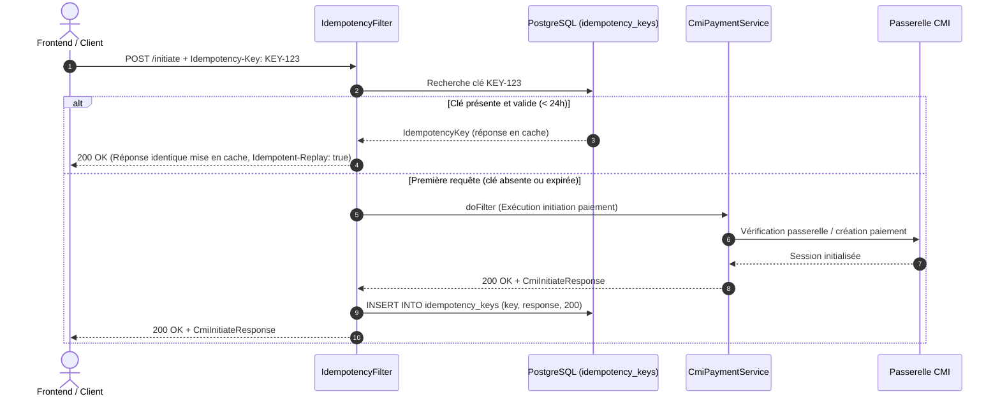

# Guide de l'Idempotence et Résilience des Paiements CMI

## 1. Vue d'ensemble

Dans une plateforme de location de véhicules comme LocaVite, la robustesse des transactions financières est critique. Ce document décrit l'architecture mise en œuvre pour :
1. **Garantir l'idempotence des paiements** : éviter tout risque de double débit lors des soumissions répétées ou des retries réseau côté client.
2. **Assurer la résilience et les retries automatiques** : absorber les défaillances réseau ou les lenteurs temporaires de la passerelle CMI grâce à Resilience4j.

---

## 2. Idempotence des Paiements

### 2.1 En-tête obligatoire `Idempotency-Key`

Toute requête d'initialisation de paiement en ligne via CMI **doit obligatoirement** fournir l'en-tête HTTP `Idempotency-Key` :

```http
POST /api/payments/cmi/initiate HTTP/1.1
Host: api.locavite.ma
Authorization: Bearer <jwt-token>
Idempotency-Key: 9b1deb4d-3b7d-4bad-9bdd-2b0d7b3dcb6d
Content-Type: application/json

{
  "reservationId": 10,
  "montant": 750.00,
  "returnUrl": "https://locavite.ma/reservations/10/confirmation"
}
```

* **Si l'en-tête est manquant ou vide** : le serveur retourne immédiatement une erreur `400 Bad Request` :
  ```json
  {
    "type": "about:blank",
    "title": "Bad Request",
    "status": 400,
    "detail": "Le header 'Idempotency-Key' est obligatoire pour initier un paiement CMI"
  }
  ```

### 2.2 Table de stockage `idempotency_keys`

Les réponses sont persistées dans PostgreSQL via la table `idempotency_keys` :

```sql
CREATE TABLE IF NOT EXISTS idempotency_keys (
    key VARCHAR(255) PRIMARY KEY,
    response TEXT NOT NULL,
    status_code INT NOT NULL DEFAULT 200,
    content_type VARCHAR(100) DEFAULT 'application/json',
    created_at TIMESTAMP WITH TIME ZONE NOT NULL DEFAULT NOW()
);
```

- **Clé primaire (`key`)** : Valeur unique fournie par le client (ex: UUID v4).
- **Réponse mise en cache (`response`)** : Corps JSON sérialisé de la réponse HTTP 200 initiale (`CmiInitiateResponse`).
- **Durée de vie (TTL)** : **24 heures**. Au-delà de ce délai, la clé est considérée expirée et peut être réémise.

### 2.3 Cycle de vie et Rejeu (Replay)



---

## 3. Résilience et Tolérance aux Pannes (Resilience4j)

L'intégration avec le Centre Monétique Interbancaire (CMI) est encapsulée via **Resilience4j** pour prévenir les pannes en cascade et gérer les indisponibilités réseau temporaires.

### 3.1 Retry Automatique (`@Retry(name = "cmi")`)

- **Nombre de tentatives** : 3 tentatives au total (1 appel initial + 2 retries).
- **Backoff exponentiel** : Délai initial de 500 ms avec multiplicateur `x2` (500 ms puis 1000 ms).
- **Exceptions réessayées** :
  - `CmiUnavailableException`
  - `org.springframework.web.client.RestClientException` / `ResourceAccessException` (Timeouts HTTP/TCP)
  - `java.io.IOException`
  - `java.util.concurrent.TimeoutException`

Configuration `application.yml` :
```yaml
resilience4j:
  retry:
    instances:
      cmi:
        maxAttempts: 3
        waitDuration: 500ms
        enableExponentialBackoff: true
        exponentialBackoffMultiplier: 2
        retryExceptions:
          - ma.locavite.payment.cmi.exception.CmiUnavailableException
          - org.springframework.web.client.RestClientException
          - java.io.IOException
          - java.util.concurrent.TimeoutException
```

### 3.2 Circuit Breaker (`@CircuitBreaker(name = "cmi")`)

Pour protéger le système lorsque CMI subit une panne prolongée :
- **Fenêtre glissante (sliding window)** : 5 derniers appels.
- **Seuil de déclenchement** : Si plus de 50% d'échecs (minimum 3 appels).
- **Comportement en état OUVERT (`OPEN`)** :
  - Toute nouvelle tentative est immédiatement rejetée sans solliciter le réseau distant via `CallNotPermittedException`.
  - Le `PaymentExceptionHandler` transforme automatiquement cette exception en HTTP `503 Service Unavailable`.
- **Délai avant réévaluation (`HALF-OPEN`)** : 10 secondes. Deux appels d'essai sont alors autorisés pour vérifier le rétablissement de la passerelle.

Configuration `application.yml` :
```yaml
resilience4j:
  circuitbreaker:
    instances:
      cmi:
        slidingWindowType: COUNT_BASED
        slidingWindowSize: 5
        minimumNumberOfCalls: 3
        failureRateThreshold: 50
        waitDurationInOpenState: 10000ms
        permittedNumberOfCallsInHalfOpenState: 2
        automaticTransitionFromOpenToHalfOpenEnabled: true
```

---

## 4. Recommandations pour les Clients API

1. **Génération de la clé** : Utilisez un identifiant unique (ex: UUID v4) généré dès le début du parcours de paiement.
2. **Retries côté client** : En cas de timeout réseau côté client, réémettez la requête avec **exactement le même `Idempotency-Key`**. Vous recevrez la réponse d'origine sans double débit.
3. **Erreur 503** : En cas de code `503 Service Unavailable`, la passerelle CMI est temporairement indisponible. Invitez l'utilisateur à réessayer ultérieurement ou à choisir un autre mode de paiement (espèces ou virement).
